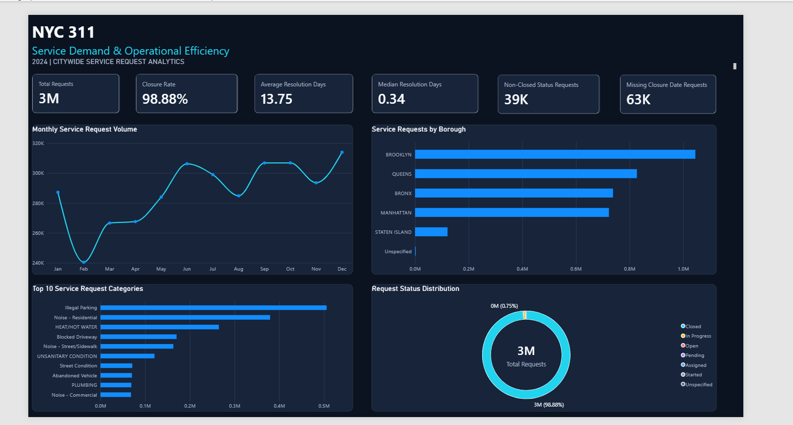
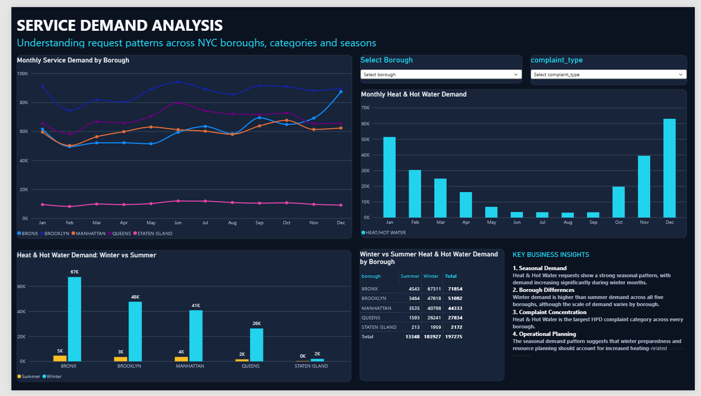
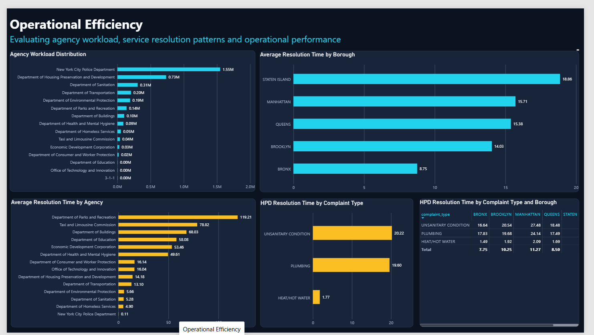
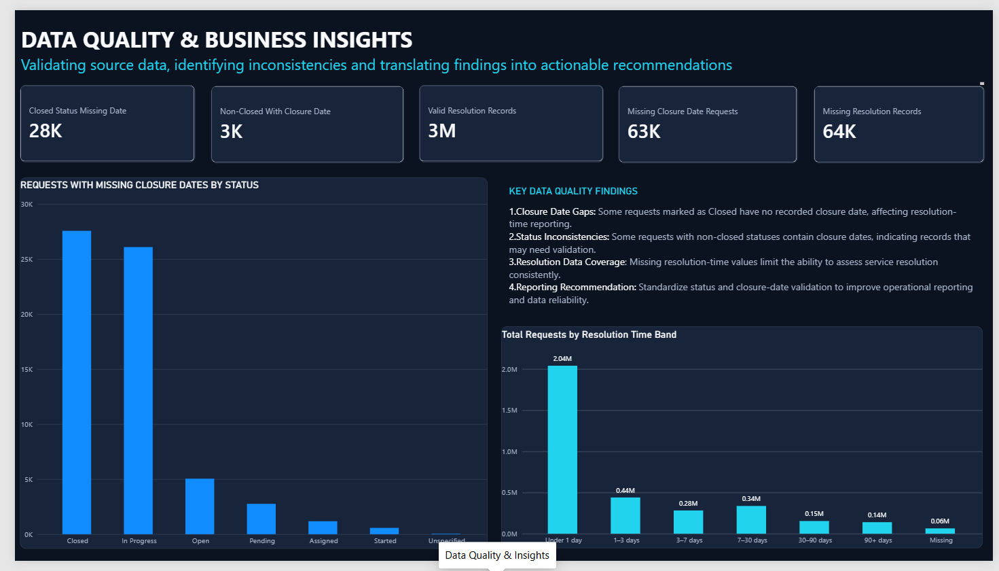

# NYC 311 Operational Analytics

An end-to-end business analytics project examining **2024 New York City 311 service requests** using MySQL and Microsoft Power BI. The project explores service demand, geographic and seasonal patterns, agency workload, resolution performance, and data quality, then translates the findings into operational recommendations.

> **Project focus:** Service Demand · Operational Efficiency · Data Quality

## Project at a Glance

| Item | Details |
|---|---|
| Analysis period | January 1 – December 31, 2024 |
| Dataset size | Approximately 3.46 million service requests |
| SQL environment | MySQL |
| Visualization | Microsoft Power BI |
| Dashboard pages | 4 |
| Core areas | Demand analysis, operational performance, data quality |

## Business Questions

1. **Service demand:** Where and when are residents requesting the most services?
2. **Operational efficiency:** How do agency workload and resolution times vary by borough, agency, and complaint type?
3. **Data reliability:** Are request status and closure-date fields sufficiently complete and consistent for operational reporting?

## Project Objectives

- Analyze service-request volume and monthly trends.
- Compare demand across NYC boroughs and complaint categories.
- Examine seasonal patterns, including Heat & Hot Water requests.
- Compare agency workload and average resolution time.
- Assess closure-date completeness and status/date consistency.
- Build an interactive Power BI dashboard and communicate actionable findings.

## Tools and Technologies

- **MySQL / SQL:** Data validation, data-quality checks, aggregations, and analytical queries.
- **Microsoft Power BI:** Data modeling, DAX measures, interactive visuals, and dashboard reporting.
- **Power Query:** Data preparation and transformation within the reporting workflow.
- **Excel:** Supporting data review and KPI documentation.

## Dataset

The project analyzes NYC 311 service requests for calendar year 2024, with approximately **3.46 million records** in the analyzed dataset.

Key analytical fields include request creation date, closure date, status, borough, agency, complaint type, and calculated resolution time.

The raw dataset is not included in this repository because of its size. Users reproducing the analysis should obtain the corresponding 2024 NYC 311 source data and confirm that the source schema aligns with the SQL script and Power BI model. The `dataset/` folder contains additional dataset information.

## Power BI Dashboard

The dashboard is organized into four pages:

| Page | Analysis | Purpose |
|---|---|---|
| 1. Executive Overview | Overall KPIs, monthly volume, borough volume, top complaint categories, and status distribution | Understand the overall service-request picture |
| 2. Service Demand Analysis | Monthly demand by borough, complaint-type filters, Heat & Hot Water trends, and seasonal comparisons | Identify geographic and seasonal demand patterns |
| 3. Operational Efficiency | Agency workload, average resolution time by agency and borough, and HPD complaint-type resolution | Compare workload and resolution performance |
| 4. Data Quality & Business Insights | Missing closure dates, status/date inconsistencies, and valid resolution records | Assess data reliability and reporting limitations |

### Dashboard Preview

| Executive Overview | Service Demand |
|---|---|
|  |  |

| Operational Efficiency | Data Quality |
|---|---|
|  |  |

The [Power BI dashboard PDF](power-bi/NYC_311_Service_Analytics.pdf) is available in this repository. The PBIX file and walkthrough video are not hosted here because they exceeded GitHub's file-size upload limit.

## Key Findings

- **Borough demand:** Brooklyn recorded the highest service-request volume; Staten Island recorded the lowest.
- **Seasonality:** Heat & Hot Water requests increased during winter.
- **Agency workload:** NYPD recorded the highest request workload among the agencies analyzed.
- **Agency resolution time:** The Department of Parks and Recreation (DPR) recorded the longest average agency resolution time.
- **Borough resolution time:** Staten Island recorded the longest average resolution time by borough.
- **HPD complaint type:** Unsanitary Condition recorded the longest average resolution time in the HPD complaint-type analysis.
- **Data quality:** The analysis identified Closed requests without closure dates and non-Closed requests with populated closure dates.
- **Resolution-time distribution:** Average resolution time was **13.75 days**, compared with a median of **0.34 days**. The difference indicates an uneven distribution and supports reviewing both measures.

## Selected KPIs

| KPI | Project result |
|---|---:|
| Total service requests | Approximately 3.46 million |
| Closure rate | 98.88% |
| Average resolution time | 13.75 days |
| Median resolution time | 0.34 days |
| Non-Closed status requests | Approximately 39,000 |
| Requests missing closure dates | Approximately 63,000 |

Values are rounded for presentation. Refer to the [KPI Definition Register](business-requirements/NYC_311_KPI_Definition_Register.xlsx) and validated SQL outputs for the authoritative definitions and exact figures.

## Data Quality Findings

The dashboard highlights these approximate counts:

- **63,000** requests with missing closure dates.
- **27,600** requests marked Closed with missing closure dates.
- **3,000** requests with a non-Closed status but a populated closure date.

These records should be investigated rather than automatically corrected. A missing closure date does not by itself prove that a request remains unresolved, and a populated closure date paired with a non-Closed status may reflect a source-system or status-definition issue.

## Business Recommendations

1. **Use borough-level demand for resource planning.** Review request volume alongside population, agency capacity, and case complexity.
2. **Prepare for seasonal demand.** Use historical winter Heat & Hot Water patterns to support advance staffing and operational planning.
3. **Investigate longer resolution times.** Review long-running cases and possible workflow constraints while accounting for differences in complaint complexity.
4. **Monitor workload and outcomes together.** Evaluate agency request volume alongside resolution-time distributions and service mix.
5. **Strengthen status/date validation.** Establish checks for Closed requests without closure dates and non-Closed requests with closure dates.
6. **Track average and median resolution time.** Use both measures and investigate unusually long-running requests.

## Project Documentation and Deliverables

- [Business Requirements Document](business-requirements/NYC_311_Business_Requirements_Document.docx)
- [KPI Definition Register](business-requirements/NYC_311_KPI_Definition_Register.xlsx)
- [SQL Analysis Script](sql/NYC_311_2024_Operational_Analytics.sql)
- [SQL Analysis Notes](sql/SQL_Analysis_Notes.docx)
- [Data Cleaning Notes](documentation/Data_Cleaning_Notes.docx)
- [Data Dictionary](documentation/Data_Dictionary.docx)
- [Project Documentation](documentation/NYC_311_Project_Documentation.docx)
- [Executive Summary (Word)](documentation/NYC_311_Executive_Summary.docx)
- [Key Findings and Recommendations (Word)](documentation/NYC_311_Key_Findings_and_Recommendations.docx)
- [Executive Summary (PDF)](deliverables/NYC_311_Executive_Summary.pdf)
- [Key Findings and Recommendations (PDF)](deliverables/NYC_311_Key_Findings_and_Recommendations.pdf)
- [Project Report (PDF)](deliverables/NYC_311_Project_Report.pdf)
- [Power BI Dashboard (PDF)](power-bi/NYC_311_Service_Analytics.pdf)

## Limitations

- This is a descriptive analysis. It identifies patterns but does not establish the causes of resolution delays or differences between agencies and boroughs.
- Request volume alone is not a measure of service quality or staffing adequacy.
- Resolution times can vary with complaint complexity, operational requirements, and data completeness.
- Average resolution time can be influenced by unusually long-running records; the median provides a complementary view.
- Rounded KPI values should be reconciled with the final KPI register and validated SQL outputs before being treated as exact.

## Repository Structure

```text
nyc-311-operational-analytics/
├── README.md
├── business-requirements/
│   ├── NYC_311_Business_Requirements_Document.docx
│   └── NYC_311_KPI_Definition_Register.xlsx
├── dataset/
│   └── README.md
├── sql/
│   ├── NYC_311_2024_Operational_Analytics.sql
│   └── SQL_Analysis_Notes.docx
├── power-bi/
│   ├── NYC_311_Service_Analytics.pdf
│   └── README.md
├── documentation/
│   ├── Data_Cleaning_Notes.docx
│   ├── Data_Dictionary.docx
│   ├── NYC_311_Executive_Summary.docx
│   ├── NYC_311_Key_Findings_and_Recommendations.docx
│   └── NYC_311_Project_Documentation.docx
├── deliverables/
│   ├── NYC_311_Executive_Summary.pdf
│   ├── NYC_311_Key_Findings_and_Recommendations.pdf
│   └── NYC_311_Project_Report.pdf
    └── NYC_311_Service_Analytics.pdf
└── screenshots/
    ├── 01_Executive_Overview.png
    ├── 02_Service_Demand.png
    ├── 03_Operational_Efficiency.png
    └── 04_Data_Quality.png
```

The raw and intermediate CSV files are intentionally excluded. The PBIX dashboard file and walkthrough video are retained separately because they exceeded GitHub's file-size upload limit.

## Conclusion

This project demonstrates how SQL and Power BI can be used together to analyze public-service demand, evaluate operational patterns, and identify data-quality issues. It connects technical analysis with practical recommendations for resource planning, seasonal preparedness, operational monitoring, and more reliable reporting.
